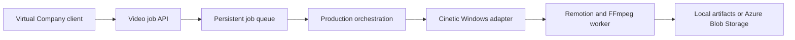

# Architecture

## Scope and ownership

VideoAIAgent is an independent service developed in this repository. Virtual Company will remain a consumer through an HTTP contract, with no Node or Python dependencies added to its .NET application. Cinetic compatibility belongs here; no separate Cinetic fork will be created.

## Intended flow

The local web studio, HTTP job API, disk-backed queue, configurable product-launch template, Windows scaffolder and Remotion/FFmpeg worker exist today. The studio's brief planner extracts editable scene text locally. Production AI direction, Virtual Company integration and cloud storage remain target architecture.

## Boundaries

| Area | Responsibility |
| --- | --- |
| `src/api` | Validate requests, expose job status, return artifact references |
| `src/ui` | Same-origin brief form, copy editor, real progress, recent jobs and MP4 preview |
| `src/agent/brief-plan.mjs` | Bounded local text extraction into a validated template specification |
| `src/jobs` | Serialize queue mutations, atomically persist job state, recover interrupted work |
| `src/agent` | Brief, treatment, scene/timeline planning and revision workflow |
| `skills/cinetic-windows` | Implemented local agent direction, critic and revision workflow |
| `src/cinetic-adapter` | Versioned upstream integration, Windows tooling and file handling |
| `src/renderer` | Bounded render execution, audio muxing, QA and progress |
| `src/templates` | Reusable compositions and input definitions |

Use Node.js 22.9+ for process orchestration. The imported Cinetic starter uses TypeScript/React with Remotion 4.0.529. Root npm packages and Python audio/QA dependencies are pinned; all Remotion packages use the same exact version. Vendored upstream source has an MIT notice and hash inventory, with no Cinetic fork.

## Local job contract

- `POST /v1/video-jobs`: validate a specification; persist it before returning 202 with a job ID and status URL.
- `GET /v1/video-jobs/{id}`: report queued/preparing/rendering/verifying/cancelling or terminal state, progress and structured errors.
- `POST /v1/video-jobs/{id}/cancel` and `/retry`: control the persisted job lifecycle.
- `GET /v1/video-jobs/{id}/video`: stream a successful MP4 with byte-range support.

See [OpenAPI](openapi.yaml), [versioned schema](video-specification.schema.json) and [local usage](local-api.md). The supported request example is `examples/product-launch.json`; the older `launch-brief.json` remains a design sketch for future agent direction. Success requires a real probed MP4; idempotency, restart recovery and cancellation have Windows acceptance evidence.

## Execution and storage

The CLI uses one worker per film under ignored `data/films/`. It freezes a source bundle, records status/logs, enforces a deadline and bounded concurrency, and gates real output. Technical and creative QA are reported separately. This trusted local authoring workflow is not an executable-code sandbox.

The service persists atomic JSON records under `data/service`, uses a single owner lock, and executes one job at a time. Interrupted jobs are rendered at least once, with a separate workspace for every attempt. Terminal success/failure and idempotency survive restart. Store/media retention is manual in this local milestone. Choose distributed Azure queue/storage services when deployment requirements are concrete.

Constrain duration, resolution, concurrency and runtime. Accept declarative inputs rather than uploaded executable compositions. Launch subprocesses with argument arrays and keep private assets and credentials out of logs. Authentication and deployment hardening are required before exposing the service beyond loopback.
