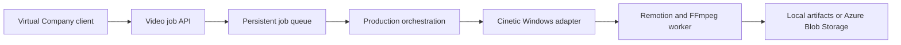

# Architecture

## Scope and ownership

VideoAIAgent is an independent service developed in this repository. Virtual Company will remain a consumer through an HTTP contract, with no Node or Python dependencies added to its .NET application. Cinetic compatibility belongs here; no separate Cinetic fork will be created.

## Intended flow

The local API's `GET /health`, Windows film scaffolder and local Remotion/FFmpeg CLI worker exist today. The HTTP job endpoints, production agent, durable queue and storage-service boxes describe the target architecture.

## Boundaries

| Area | Responsibility |
| --- | --- |
| `src/api` | Validate requests, expose job status, return artifact references |
| `src/agent` | Brief, treatment, scene/timeline planning and revision workflow |
| `src/cinetic-adapter` | Versioned upstream integration, Windows tooling and file handling |
| `src/renderer` | Bounded render execution, audio muxing, QA and progress |
| `src/templates` | Reusable compositions and input definitions |

Use Node.js 22.9+ for process orchestration. The imported Cinetic starter uses TypeScript/React with Remotion 4.0.529. Root npm packages and Python audio/QA dependencies are pinned; all Remotion packages use the same exact version. Vendored upstream source has an MIT notice and hash inventory, with no Cinetic fork.

## Proposed job contract (not implemented)

- `POST /v1/video-jobs`: validate a specification; persist it before returning 202 with a job ID and status URL.
- `GET /v1/video-jobs/{id}`: report `queued`, `planning`, `rendering`, `succeeded`, `failed`, or `cancelled`, progress and structured errors.
- `GET /v1/video-jobs/{id}/artifacts`: return authorized output references after verification.

Define a versioned schema and OpenAPI contract before adding endpoints. `examples/launch-brief.json` is design input, not a supported request contract. Successful status must require an actual probed output. Plan for idempotent submission, restart recovery and cancellation before connecting VC.

## Execution and storage

The CLI uses one worker per film under ignored `data/films/`. It freezes a source bundle, records status/logs, enforces a deadline and bounded concurrency, and gates real output. Technical and creative QA are reported separately. This trusted local authoring workflow is not an executable-code sandbox.

Add a durable queue and metadata store with the job API; choose Azure services when deployment requirements are concrete. Move artifacts to Azure Blob Storage behind a storage interface later.

Constrain duration, resolution, concurrency and runtime. Accept declarative inputs rather than uploaded executable compositions. Launch subprocesses with argument arrays and keep private assets and credentials out of logs. Authentication and deployment hardening are required before exposing the service beyond loopback.
